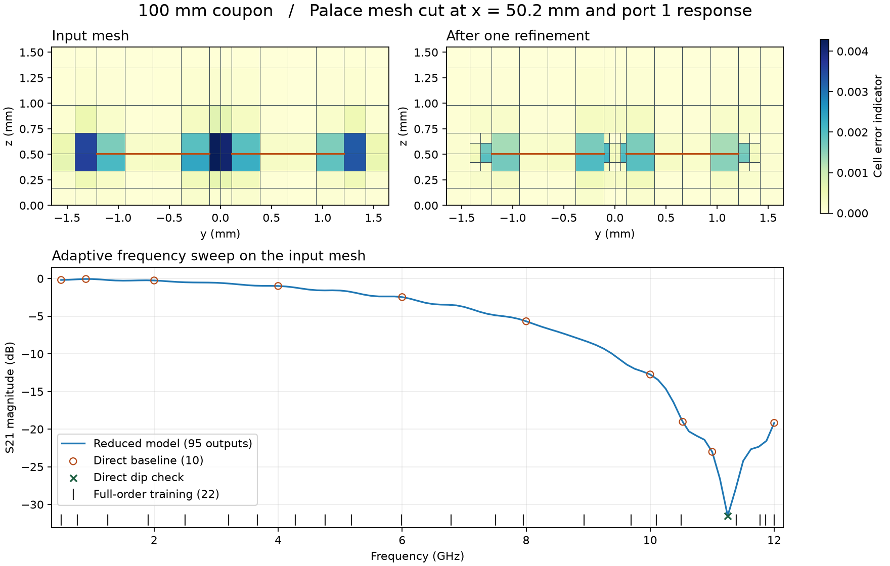

# Palace adaptivity on the 100 mm coupon

These experiments start from the same Gmsh mesh, excite port 1 and retain all four 50 Ω ports.
The first changes the mesh at one frequency. The second holds the mesh fixed and uses full-order
solutions at selected frequencies to build a reduced-order model of the frequency response.



The orange lines in the cross sections locate the two copper strips. Both panels use the same
indicator scale. The frequency panel marks each full-order training solve along the bottom axis.

## Reproduce

Start from a completed direct baseline. To generate the one used here, run from the checkout:

```sh
runs="$HOME/.local/state/guvna/coupler"
baseline="$runs/long-100mm-split-ground"
bazel run //coupler:solve -- --length 100 --length-cells 150 --output "$baseline" \
  --save-ghz 0.5 0.9 2 4 6 8 10 10.525 11 12
```

From the checkout, prepare the studies in a new directory and run the source-built solvers:

```sh
study="$runs/study-100mm-v1"
bazel run //coupler:prepare_study -- "$baseline" "$study"
bazel build //tools/palace/source:palace_cpu //tools/palace/source:palace_gpu
solver_dir="$(realpath bazel-bin/tools/palace/source)"
export OMP_NUM_THREADS=1 OPENBLAS_NUM_THREADS=1
(cd "$study/mesh" && "$solver_dir/palace_cpu" -np 4 palace.json > solver.log 2>&1)
(cd "$study/frequency" && "$solver_dir/palace_gpu" -np 1 palace.json > solver.log 2>&1)
bazel run //viewer:serve -- --run "$baseline" --run "$study/mesh" --run "$study/frequency"
```

The preparer accepts `--field-ghz`, `--mesh-iterations`, `--adaptive-tol`, `--sample-limit` and
`--output-step-ghz`. Choose another destination for each trial to preserve the comparison.
The frequency deck selects CUDA/MAGMA for kratos. On a CPU-only host set `Solver.Device` to
`CPU`, remove `Solver.Backend`, and run that deck with the CPU executable.

## Where did Palace refine?

At 10.525 GHz Palace v0.19.0 marked 894 of 24,000 hexahedra. They accounted for 70.02% of the
summed squared element indicators. After subdivision the mesh had 30,258 cells and 735,234
unknowns, up from 611,236. At a cross section halfway down the coupon, subdivision concentrates
at the facing strip edges and the two outer strip edges. The global indicator fell from 0.1528
to 0.1172. The solver stopped at the one-refinement cap with its tolerance still unmet. Palace
reported 28.0 s total on four CPU ranks.

| P1 excitation at 10.525 GHz | Original, dB | After one refinement, dB |
| --- | ---: | ---: |
| S11 | −15.500 | −15.482 |
| S21 | −19.030 | −18.900 |
| S31 | −27.739 | −27.441 |
| S41 | −0.220 | −0.222 |

In ParaView, open these two collections relative to `mesh/postpro`:

- `iteration1/paraview/driven/driven.pvd` contains the original solve.
- `paraview/driven/driven.pvd` contains the solve after refinement.

Select timestep 999, choose the cell array **Indicator**, and use **Slice** normal to X at
50.2 mm with **Surface With Edges**. Use identical color limits on both meshes. Timestep 999
is Palace's diagnostic output. The physical field is at timestep 10.525. The browser's **Gmsh
mesh** layer shows the input file. The saved volume field in the browser's mesh study comes
from the final Palace mesh.

## Where did Palace solve across frequency?

On one RTX 4070 Ti, the fixed-mesh sweep used 22 full-order training frequencies for a basis of
dimension 44. Its last two estimated errors were 1.625e−4 and 2.916e−4, below the 1e−3
tolerance. Training took 79.1 s of the 86.0 s total. The log lists the training frequencies in
selection order under `Sampled frequencies (GHz)`. The 95 rows in `postpro/port-S.csv` are
evaluations of the finished reduced model. Only 10.525 GHz has saved 3D fields in this study.

Across all four complex coefficients at the ten original direct frequencies, the largest
absolute difference was 1.31e−5 in S21 at 11 GHz. The two band endpoints were training seeds.
The denser sweep also revealed an S21 dip at 11.25 GHz, between baseline samples. A separate
full-order GPU check there gave −31.52524 dB, versus −31.52627 dB from the reduced model.
This checks the response at the sampled dip. Locating its exact minimum needs a finer grid.

To repeat that check, copy the frequency deck and mesh into a fresh directory, replace
`Solver.Driven` with `{"Samples": [{"Type": "Point", "Freq": [11.25]}]}` and run the same GPU
command there. Keeping the mesh fixed isolates the frequency approximation. Repeat the mesh
experiment with two or more refinements to measure spatial convergence separately.
