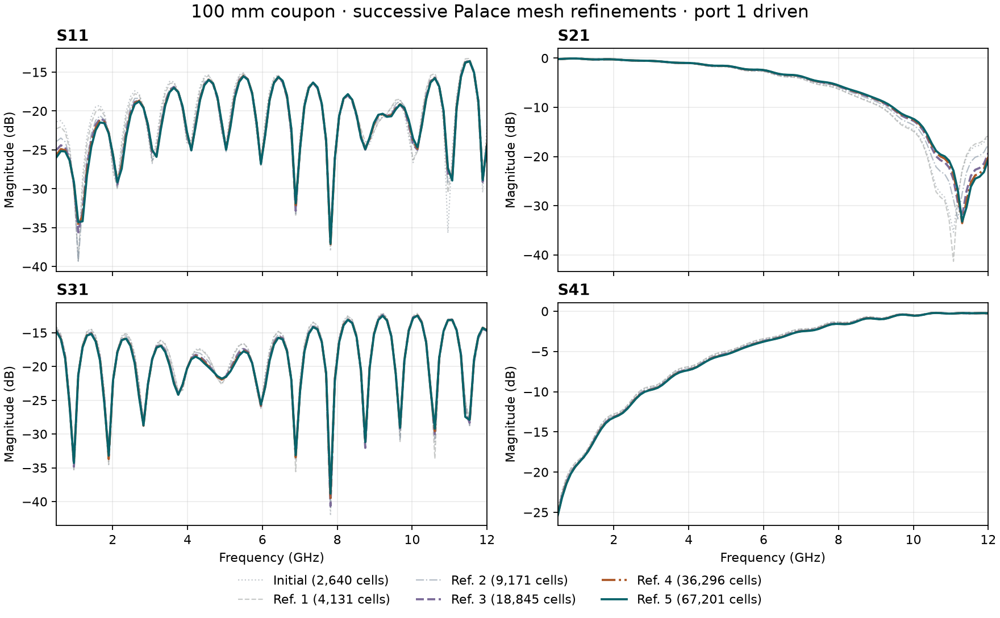

# Palace adaptivity on the 100 mm coupon

These experiments start from the same Gmsh mesh, excite port 1 and retain all four 50 Ω ports.
The first changes the mesh at one frequency. The second holds the mesh fixed and uses full-order
solutions at selected frequencies to build a reduced-order model of the frequency response.


The orange lines in the cross sections locate the two copper strips. Both panels use the same
indicator scale. The frequency panel marks each full-order training solve along the bottom axis.

## Reproduce

Start from a completed direct baseline. To generate the one used here, run from the checkout:

```sh
runs="$HOME/.local/state/guvna/coupler"
baseline="$runs/long-100mm-split-ground"
bazel run //coupler:solve -- --length 100 --length-cells 150 --output "$baseline" \
  --save-ghz 0.5 0.9 2 4 6 8 10 10.525 11 12
```

From the checkout, prepare the studies in a new directory and run the source-built solvers:

```sh
study="$runs/study-100mm-v1"
bazel run //coupler:prepare_study -- "$baseline" "$study"
bazel build //tools/palace/source:palace_cpu //tools/palace/source:palace_gpu
solver_dir="$(realpath bazel-bin/tools/palace/source)"
export OMP_NUM_THREADS=1 OPENBLAS_NUM_THREADS=1
(cd "$study/mesh" && "$solver_dir/palace_cpu" -np 4 palace.json > solver.log 2>&1)
(cd "$study/frequency" && "$solver_dir/palace_gpu" -np 1 palace.json > solver.log 2>&1)
bazel run //viewer:serve -- --run "$baseline" --run "$study/mesh" --run "$study/frequency"
```

The preparer accepts `--field-ghz`, `--mesh-iterations`, `--adaptive-tol`, `--sample-limit` and
`--output-step-ghz`. Choose another destination for each trial to preserve the comparison.
The frequency deck selects CUDA/MAGMA for kratos. On a CPU-only host set `Solver.Device` to
`CPU`, remove `Solver.Backend`, and run that deck with the CPU executable.

## Where did Palace refine?

At 10.525 GHz Palace v0.19.0 marked 894 of 24,000 hexahedra. They accounted for 70.02% of the
summed squared element indicators. After subdivision the mesh had 30,258 cells and 735,234
unknowns, up from 611,236. At a cross section halfway down the coupon, subdivision concentrates
at the facing strip edges and the two outer strip edges. The global indicator fell from 0.1528
to 0.1172. The solver stopped at the one-refinement cap with its tolerance still unmet. Palace
reported 28.0 s total on four CPU ranks.

| P1 excitation at 10.525 GHz | Original, dB | After one refinement, dB |
| --- | ---: | ---: |
| S11 | −15.500 | −15.482 |
| S21 | −19.030 | −18.900 |
| S31 | −27.739 | −27.441 |
| S41 | −0.220 | −0.222 |

In ParaView, open these two collections relative to `mesh/postpro`:

- `iteration1/paraview/driven/driven.pvd` contains the original solve.
- `paraview/driven/driven.pvd` contains the solve after refinement.

Select timestep 999, choose the cell array **Indicator**, and use **Slice** normal to X at
50.2 mm with **Surface With Edges**. Use identical color limits on both meshes. Timestep 999
is Palace's diagnostic output. The physical field is at timestep 10.525. In the browser, select
**Initial solve** or **Refinement 1** under **Mesh stage** to see its mesh and open its saved field.

## Where did Palace solve across frequency?

On one RTX 4070 Ti, the fixed-mesh sweep used 22 full-order training frequencies for a basis of
dimension 44. Its last two estimated errors were 1.625e−4 and 2.916e−4, below the 1e−3
tolerance. Training took 79.1 s of the 86.0 s total. The log lists the training frequencies in
selection order under `Sampled frequencies (GHz)`. The 95 rows in `postpro/port-S.csv` are
evaluations of the finished reduced model. Only 10.525 GHz has saved 3D fields in this study.

Across all four complex coefficients at the ten original direct frequencies, the largest
absolute difference was 1.31e−5 in S21 at 11 GHz. The two band endpoints were training seeds.
The denser sweep also revealed an S21 dip at 11.25 GHz, between baseline samples. A separate
full-order GPU check there gave −31.52524 dB, versus −31.52627 dB from the reduced model.
This checks the response at the sampled dip. Locating its exact minimum needs a finer grid.

To repeat that check, copy the frequency deck and mesh into a fresh directory, replace
`Solver.Driven` with `{"Samples": [{"Type": "Point", "Freq": [11.25]}]}` and run the same GPU
command there. Keeping the mesh fixed isolates the frequency approximation. Repeat the mesh
experiment with two or more refinements to measure spatial convergence separately.

## Inspect three refinements in the browser

This separate run keeps the 100 mm geometry and reduces the starting mesh from 24,000 cells to
2,640. The node counts across the strip edges and gap still respect the material and port
boundaries. Run the following commands from the checkout to reproduce it in fresh directories.

```sh
runs="$HOME/.local/state/guvna/coupler"
seed="$runs/coarse-100mm-seed"
study="$runs/coarse-100mm-study"
bazel run //coupler:solve -- --length 100 --length-cells 48 --side-cells 3 --strip-cells 2 \
  --gap-cells 1 --substrate-cells 2 --air-cells 3 --frequencies-ghz 0.5 10.525 \
  --save-ghz 10.525 --output "$seed"
bazel run //coupler:prepare_study -- "$seed" "$study" --mesh-iterations 3
bazel build //tools/palace/source:palace_cpu
solver="$(realpath bazel-bin/tools/palace/source/palace_cpu)"
(cd "$study/mesh" && OMP_NUM_THREADS=1 OPENBLAS_NUM_THREADS=1 \
  "$solver" -np 4 palace.json > solver.log 2>&1)
bazel run //viewer:serve -- --run "$study/mesh"
```

Open **Cut plane**, choose X and enter 50.2 mm. Choose **Right** for an end-on view and zoom in
on the cross section. Step through **Mesh stage** with the arrows. Input and initial solve have
the same cell count here. The labeled initial solve also has the original fields and S-parameters.

| Stage at 10.525 GHz | Cells | Degrees of freedom | Global indicator | S21 (dB) |
| --- | ---: | ---: | ---: | ---: |
| Initial solve | 2,640 | 70,072 | 0.2096 | −24.018 |
| Refinement 1 | 4,075 | 97,390 | 0.1669 | −24.715 |
| Refinement 2 | 8,912 | 197,604 | 0.1296 | −21.151 |
| Refinement 3 | 18,383 | 392,314 | 0.0991 | −19.027 |

The last refinement still moves S21 by 2.12 dB. These stages illustrate where the error
estimator drives subdivision. The iteration cap leaves spatial convergence open.

## Compare sweeps across mesh stages

Start with the coarse 100 mm seed above. This study solves for port 1 and reports S11, S21, S31
and S41 on the same 100-point linear grid from 0.5 through 12 GHz at each mesh stage. The spacing
is 11.5/99 GHz (about 116.16 MHz). The setup uses the seed geometry and port definitions. It
replaces the seed frequency settings and saves 3D fields at both band edges.

```sh
runs="$HOME/.local/state/guvna/coupler"
study="$runs/band-100pt-amr"
bazel run //coupler:prepare_study -- "$runs/coarse-100mm-seed" "$study" \
  --band-ghz 0.5 12 --output-points 100 --mesh-iterations 3 --adaptive-tol 1e-4 --sample-limit 36
bazel build //tools/palace/source:palace_cpu
solver="$(realpath bazel-bin/tools/palace/source/palace_cpu)"
(cd "$study" && OMP_NUM_THREADS=1 OPENBLAS_NUM_THREADS=1 \
  "$solver" -np 4 palace.json > solver.log 2>&1)
bazel run //viewer:serve -- --run "$study"
```

Palace trains the reduced frequency model again on each mesh. Full-order training fields across
the band contribute to the mesh error indicator that drives the next subdivision. At each stage
the reduced model produces 100 complex response samples. The mesh tolerance is 0.01.

In **Port response**, select a refinement and use **Previous mesh** to overlay adjacent
magnitude or phase curves. **|ΔS|** shows the absolute complex change, including
phase, at each common sample. Inspect dB movement separately around deep nulls. For a stopping
rule, choose an allowable complex change for each important trace and check its maximum over the
grid on two successive refinements. Features narrower than the grid spacing need extra samples.

The initial mesh and first three refinements took 448.5 s on four CPU MPI ranks. The GPU
continuation uses the same four traces and 100 frequencies. Each change in the table is the
largest absolute complex difference from the preceding mesh across those traces and frequencies.

| Mesh | Cells | Full training solves | Max complex change | Sampled S21 minimum |
| --- | ---: | ---: | --- | --- |
| Initial | 2,640 | 25 | — | −35.39 dB at 11.071 GHz |
| Refinement 1 | 4,131 | 24 | 0.0220 (S41 at 11.884 GHz) | −41.31 dB at 11.071 GHz |
| Refinement 2 | 9,171 | 23 | 0.0367 (S21 at 11.652 GHz) | −32.68 dB at 11.187 GHz |
| Refinement 3 | 18,845 | 24 | 0.0263 (S21 at 11.768 GHz) | −32.08 dB at 11.303 GHz |
| Refinement 4 | 36,296 | 23 | 0.0100 (S41 at 11.652 GHz) | −33.56 dB at 11.303 GHz |
| Refinement 5 | 67,201 | 24 | 0.00619 (S41 at 12.000 GHz) | −33.23 dB at 11.303 GHz |

The original run reached its three-refinement cap with a global indicator of 0.0992. Direct solves
on refinements 2 and 3 at 11.303 and 11.768 GHz agreed with their reduced models to
within 9.3e−7 in absolute complex S across the four traces. At those frequencies the response
change with mesh refinement was more than four orders of magnitude larger.



## Continue from the saved GPU mesh

The GPU study reloaded the saved third mesh (18,845 cells, 402,092 unknowns) as `Model.Mesh`
with `Nonconformal` enabled. Restarting from the mesh recomputes its adaptive frequency sweep.
The largest change across the 400 complex S values on that mesh was 1.83e−13.

Two CUDA/MAGMA attempts stopped during fourth-mesh training when VRAM was nearly full. The
second used MFEM managed memory. A third attempt completed training with a smaller memory
reservation but reported zero error in every cell. A direct 12 GHz check on the same mesh gave
an indicator of 0.0773283 on both CPU and shared CUDA. MAGMA again returned zero despite agreeing
with CPU to within 1.6e−11 in complex S. A zero indicator here would stop mesh refinement early.

The continuation uses one GPU MPI rank, one OpenMP thread and libCEED's `/gpu/cuda/shared`
backend. The run's launcher selects `MFEM_MEMORY=cuda` and sets HYPRE's initial device pool to
128 MiB using `HYPRE_SetUmpireDevicePoolSize`. The GMRES restart dimension is 20, with a 200
iteration cap and relative tolerance 1e−9. The reduced-model tolerance is 1e−4. Palace marked
3,790 cells on refinement 4, accounting for 70.01% of its squared indicator.

The successful two-stage run took 555.7 s and peaked at 9,448 MiB of sampled device-wide memory.
Refinement 5 finished with 1,382,128 field unknowns and a global indicator of 0.0580, above the
0.01 target at the requested iteration cap. Its GPU port values agreed with an independent
12 GHz direct CPU solve on the same mesh to within 2.0e−8 in absolute complex S. The sampled
S21 minimum stayed at 11.303 GHz on the last three meshes and moved by 0.33 dB on the final step.
