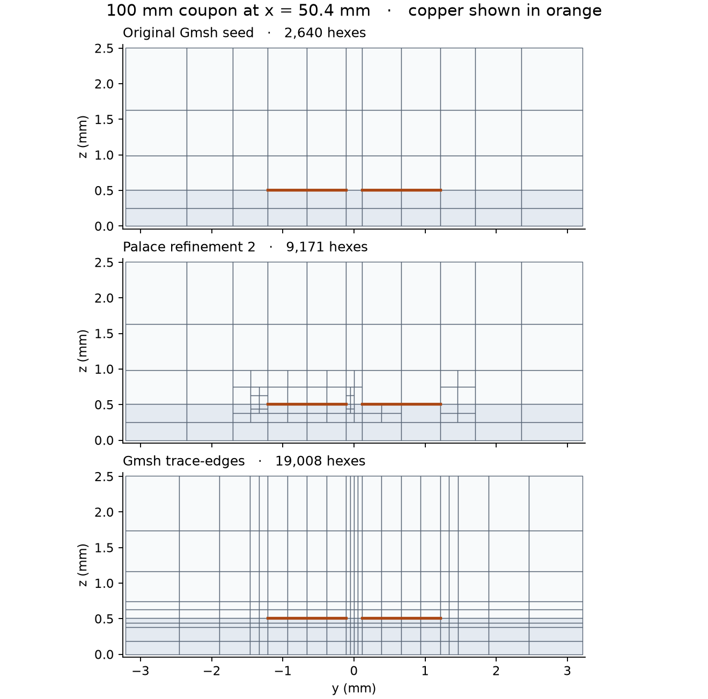

# Uniform coupled microstrip coupon

The trial section runs 8 mm along x between two lumped-port reference planes. Two straight
conductors sit at z = 0.508 mm on a lossless substrate with relative permittivity 3.48.
Both conductors are 1.1 mm wide and the edge-to-edge gap is 0.22 mm. These dimensions are
provisional. An isolated microstrip estimate with width/height = 2.165 and effective
permittivity 2.725 gives 51.7 ohms before including the nearby trace and enclosure. The coupled
even and odd modes have different impedances. The section extends all the way to the port planes.

The lower and upper metal walls are the ground plane at z = 0 and a flat lid 2 mm above the
strips. Each lateral metal wall is 2 mm away from the adjacent strip edge. The two x end faces
are magnetic walls except for the four port sheets. This termination represents the simulation's
end treatment. A coupon with physical launches and wall openings will have different fields.

| Physical tag | Location | Role |
| --- | --- | --- |
| 1, 2 | Below and above traces | Substrate and air volumes |
| 10 | Lid and both y walls | Enclosure PEC |
| 11, 12 | Interface at z = 0.508 mm | Zero-thickness main and pickup PEC strips |
| 13 | Both x ends except the port sheets | Natural magnetic boundary |
| 14 | Bottom face at z = 0 | Ground plane PEC |
| 21, 22 | Negative-y strip at x = 0 and 8 mm | Port 1 input and port 2 through |
| 23, 24 | Positive-y strip at x = 0 and 8 mm | Port 3 near pickup and port 4 far pickup |

The viewer shows **Ground plane** under **Conductors** by default. Choose **Bottom** to inspect
its return current with the enclosure hidden. Runs created before the split store the ground, lid
and side walls together under tag 10.

Each rectangular port spans one trace width and connects vertically to ground. The integration
direction is +z at all four ports. Port 3 is the candidate forward-coupled port for the
backward-wave coupled pair. Preserve the signed coupling-to-isolation ratio to test that choice.
The model omits feed-line transitions, finite copper thickness, surface roughness and losses.

## Mesh

From the checkout, generate the standard resolutions with Bazel. Each output directory receives an
ASCII Gmsh 2.2 model.msh and geometry.json with the dimensions, port map, physical groups and
mesh counts. The geometry uses the Gmsh Python API. Bazel fetches Gmsh 4.15.2, CPython 3.13
and shared libraries pinned by SHA-256 for Linux x86-64. A display and a system Gmsh install
are unnecessary. The geometry and mesh generation run on one CPU thread.

```sh
bazel run //geometry:generate -- --output /tmp/guvna-mesh0
bazel run //geometry:generate -- --output /tmp/guvna-mesh1 --refinement 1
```

The model extrudes one conforming cross section of quadrilaterals. Internal PEC trace sheets
share nodes with the air and substrate hexes. Nonuniform spacing concentrates cells near the
trace plane and the outer trace edges. The refinement increases resolution in all three axes.

| Refinement | x intervals | Across gap | Through substrate | Hexes | Quads per port |
| --- | --- | --- | --- | --- | --- |
| 0 | 12 | 2 | 3 | 1,920 | 12 |
| 1 | 20 | 4 | 5 | 8,840 | 35 |

The generator checks both material volumes, the area of every surface group, the reference
plane and extent of each port, consistency of boundary-to-volume adjacency, and positive
element orientation. All geometric elements are first order. The Palace deck independently
sets the finite-element approximation order.

Use `--length`, `--width`, `--gap`, `--substrate-height`, `--lid-clearance`, and
`--side-clearance` to override the dimensions in millimetres. Use `--relative-permittivity`
to change the substrate dielectric constant. The counts for presets 0 and 1 stay fixed as
dimensions change. Check convergence again when a sweep changes the dimensions substantially.

For a targeted mesh check, change one feature while holding the geometry and other counts fixed.

```sh
bazel run //geometry:generate -- --output /tmp/guvna-finer-gap --gap-cells 6
```

`--gap-cells`, `--strip-cells` and `--side-cells` set transverse counts through the coupling
gap, across each strip and between each outer edge and its side wall. `--length-cells` sets
the longitudinal count. `--substrate-cells` and `--air-cells` control the two vertical
intervals. Each accepts a positive integer and overrides the corresponding preset entry.
For Python callers, `MeshPolicy.preset(level)` supplies the same counts; use
`dataclasses.replace(policy, gap_cells=6)` to vary a feature. The output metadata records the
actual interval counts and any changes from the preset.

The geometry.json sidecar identifies the mesh with `mesh_file`. Its physical groups carry optional
display labels, colours and visibility defaults. Each mesh sizing rule records its axis, number of
intervals, and bounding boxes in millimetres. A viewer can display those annotations alongside the
boundary conditions and material parameters from the Palace deck.

`from geometry import CoupledMicrostrip, Dimensions, MeshPolicy, PortSheet` exposes the model
and mesh inputs without loading Gmsh. Each `PortSheet` defines an x-normal rectangular
terminal with a ground height and a +z integration direction. The model, Gmsh entity selector
and exported-mesh checks share the same terminal definitions.

## Trace-edge refinement study

The `trace-edges` preset comes from the saved Palace meshes for the 100 mm coupon and the
100-point, 0.5–12 GHz port-1 sweep. Binning refinement-2 cell centres into the original Gmsh
hexes gave 6,531 net added cells. Of those, 6,503 fell into the seven transverse columns
from y = −1.702 to +1.702 mm in the two layers touching the strips (z = 0.254 to 0.987 mm).
The finest cells occurred in the gap and immediately outside the outer strip edges, between
z = 0.381 and 0.748 mm. Refinement extended along the coupon and favoured the driven strip.



The preset uses symmetric sizing on the two strips so it can be used for any port excitation.
Each band edge is a Gmsh mesh line. The optional regions in the viewer show the same spans
used to generate the mesh. The structured cross section extends each Y band through both
materials and each Z band across the board. Palace can subdivide an individual hex locally.

| Span | Extent on the 100 mm coupon | Default count | Cell size |
| --- | --- | ---: | ---: |
| Gap | Between the inner edges | 4 | 0.055 mm |
| Outer trace edges | First 0.25 mm outside each strip | 2 per side | 0.125 mm |
| Substrate at traces | First 0.127 mm below both strips | 2 | 0.0635 mm |
| Air at traces | First 0.24 mm above both strips | 2 | 0.12 mm |
| Propagation | Entire 100 mm length | 96 | 1.042 mm |

The outer band spans one eighth of the side clearance and the air band spans 12% of the lid
clearance, each capped at half the substrate thickness. The lower band spans one quarter of the
substrate thickness. The extrusion uses 96 intervals per 100 mm, rounded up. Use
`--length-cells` to study longitudinal resolution independently. The recorded Palace
refinement-2 mesh had longitudinal pitches of 2.083, 1.042 and 0.521 mm.

To vary only the lateral spacing outside the strips, generate independent meshes and inspect
the regions and cuts in the viewer. Set `--edge-cells 0` to remove the outer bands, or
`--interface-cells 0` to remove both trace-plane layers. When a band is present,
`--side-cells`, `--substrate-cells` and `--air-cells` apply to the remaining spans.

```sh
study=$(mktemp -d)
for n in 1 2 4; do
  bazel run //geometry:generate -- --output "$study/edge-$n" --length 100 \
    --refinement trace-edges --edge-cells "$n"
done
bazel run //viewer:serve -- --run "$study/edge-1" --run "$study/edge-2" --run "$study/edge-4"
```

The same controls pass through `//coupler:solve` for a four-port direct sweep. For example,
repeat this command in fresh output directories with different `--edge-cells` values.

```sh
bazel run //coupler:solve -- --output "$study/solve-edge-2" --length 100 \
  --refinement trace-edges --edge-cells 2 --frequencies-ghz 0.5 7.81818182 12 --save-ghz 12
```

### What changed in the solve

Each fixed Gmsh mesh was solved on one GPU rank over the same 100 frequencies. The comparison
uses Palace refinement 5 (67,201 cells) as a common reference. Maximum |ΔS| includes phase
and takes the maximum across all four port-1 responses and all sampled frequencies.
ΔD is the pointwise difference in raw directivity, using ports 3 and 4 for the pickups.

| Mesh | Hexes | Max complex difference | Median absolute ΔD | Max absolute ΔD | Solve time |
| --- | ---: | ---: | ---: | ---: | ---: |
| Palace refinement 2 | 9,171 | 0.04161 | 0.22 dB | 2.39 dB | — |
| Gmsh, 48 along x, 1 per outer band | 8,640 | 0.01987 | 0.24 dB | 10.27 dB | 73 s |
| Gmsh, 48 along x, 2 per outer band | 9,504 | 0.02009 | 0.22 dB | 17.71 dB | 83 s |
| Gmsh, 96 along x, 2 per outer band | 19,008 | 0.01163 | 0.14 dB | 2.51 dB | 118 s |

All three Gmsh meshes showed their largest directivity discrepancy at 7.818 GHz, where S31
has a deep null. At 48 longitudinal intervals, refining only the outer bands deepened that null.
At two cells per band, doubling the longitudinal count reduced the directivity discrepancy
there by 15.19 dB. This motivated the 96-interval choice for the 100 mm preset. Comparing the
chosen preset directly with Palace refinement 2, the median absolute directivity difference
was 0.13 dB and the largest was 1.88 dB. The absolute depth of the null remains mesh-sensitive.

### Replay the 100-point comparison

Use a completed band-study deck for the same physical coupon. Its mesh filename is `model.msh`.
The following runs keep the original frequency grid, adaptive frequency tolerance, port 1
excitation and field saves. Each run uses its generated Gmsh mesh for the entire sweep.

```sh
reference="$HOME/.local/state/guvna/coupler/band-100pt-amr-through-ref5/palace.json"
study=$(mktemp -d)
bazel build //tools/palace/source:palace_gpu
solver=$(realpath bazel-bin/tools/palace/source/palace_gpu)
for settings in "48 2" "48 1" "96 2"; do
  read -r nx edge <<< "$settings"
  run="$study/x${nx}-edge${edge}"
  bazel run //geometry:generate -- --output "$run" --length 100 \
    --refinement trace-edges --length-cells "$nx" --edge-cells "$edge"
  jq 'del(.Model.Refinement) | .Solver.Backend = "/gpu/cuda/shared"' \
    "$reference" > "$run/palace.json"
  (cd "$run" && OMP_NUM_THREADS=1 OPENBLAS_NUM_THREADS=1 "$solver" -np 1 palace.json >solver.log)
done
```
